

**Министерство Образования Российской Федерации**

Пермский Государственный Национальный Исследовательский университет

Государственного и муниципального управления

# Отчёт по лабораторной работе №2

по дисциплине: **«Язык программирования C++»**

Выполнил: студент ИТ-5, 2 курс **Кудряшов Иван**

Руководитель: Ракина В.Д.

г. Пермь, 2026

---

## Содержание

1. [Задание 1. Заполнение и доступ к элементам. Обратные итераторы](#задание-1)
2. [Задание 2. Вставка элементов в список](#задание-2)
3. [Задание 3. Удаление элементов дека](#задание-3)
4. [Задание 4. Итераторы и алгоритмы](#задание-4)
5. [Задание 5. Алгоритмы поиска](#задание-5)
6. [Задание 6. Базовые модифицирующие алгоритмы](#задание-6)
7. [Задание 7. Сортировка и слияние](#задание-7)
8. [Задание 8. Числовые алгоритмы](#задание-8)
9. [Задание 9. Множества](#задание-9)
10. [Задание 10. Отображения](#задание-10)

---

## Задание 1

**Задача 6. Заполнение и доступ к элементам. Обратные итераторы**

**Текст задачи:**
Даны вектор `V`, дек `D` и список `L`. Каждый исходный контейнер содержит не менее трёх элементов, количество элементов является нечётным. Удвоить значения первого, среднего и последнего элемента каждого из исходных контейнеров.

**Алгоритм решения:**

1. Так как логика для вектора, дека и списка одинакова, создаётся шаблонная функция `processContainer(Container& c, ...)`.
2. Внутри функции с помощью итераторов определяются позиции:
   - первого элемента (`c.begin()`),
   - последнего элемента (`std::prev(c.end())`),
   - среднего элемента (`std::next(c.begin(), c.size() / 2)`).
3. Значения по этим итераторам умножаются на 2 (`*it *= 2`).
4. В `main` организован цикл ввода элементов с проверкой на то, что размер контейнера нечётный и не меньше 3.

**Тестирование:**

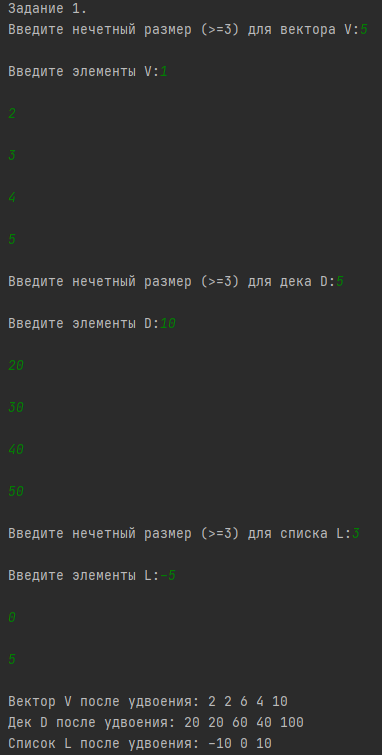

Программа успешно обрабатывает контейнеры любого размера (согласно условию — нечётного и >= 3) и корректно находит первый, средний и последний элементы, используя итераторы. Шаблонная функция `processContainer` доказала свою работоспособность для вектора, дека и списка.

---

## Задание 2

**Задача 3. Вставка элементов в список**

**Текст задачи:**
Дан список `L`, количество элементов которого делится на 3. Добавить в конец списка первую треть его исходных элементов в обратном порядке. Использовать один вызов функции-члена `insert`.

**Алгоритм решения:**

1. Считать размер списка и его элементы.
2. Создать итератор, указывающий на начало второй трети (через `std::advance` на `size / 3`).
3. Вызвать `L.insert(L.end(), ...)`, передав обратные итераторы от начала второй трети до начала списка (`std::make_reverse_iterator(it)` и `L.rbegin()`).

**Тестирование:**

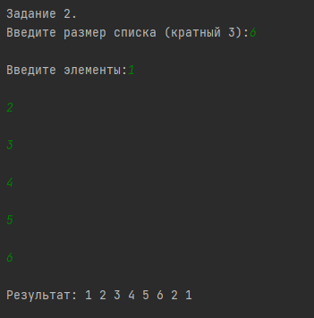

Первая треть `[1, 2]` была успешно перевёрнута и добавлена в конец списка.

---

## Задание 3

**Задача 9. Удаление элементов дека**

**Текст задачи:**
Дан дек `D` с количеством элементов, кратным 4. Удалить в первой половине исходного дека все элементы с чётными порядковыми номерами. Использовать функцию-член `erase` в цикле с числовым параметром.

**Алгоритм решения:**

1. Считать дек `D`.
2. Создать итератор на начало.
3. В цикле, повторяющемся `N/4` раз: инкрементировать итератор (пропуск нечётного), затем удалить элемент `it = D.erase(it)` (удаление чётного).

**Тестирование:**

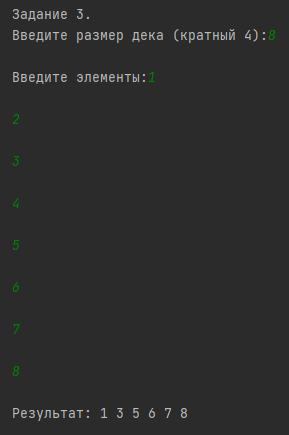

Из первой половины `[1, 2, 3, 4]` были удалены чётные порядковые номера (2 и 4). Вторая половина осталась нетронутой.

---

## Задание 4

**Задача 4. Итераторы и алгоритмы**

**Текст задачи:**
Дана строка `name` и набор целых чисел. Записать в текстовый файл все числа из набора в том же порядке, заменяя каждое число 0 на 10 и добавляя после каждого числа два пробела. Использовать `replace_copy`.

**Алгоритм решения:**

1. Считать числа в вектор `V`.
2. Открыть файл `name.txt`.
3. Использовать `std::replace_copy`, передав в качестве приёмника `std::ostream_iterator<int>(file, "  ")` (два пробела) и параметры замены 0 на 10.

**Тестирование:**

Вывод в консоли:

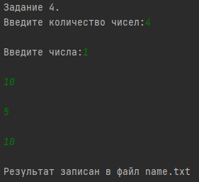

Содержимое файла:

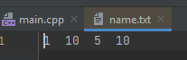

Программа корректно заменила нули и записала числа с двумя пробелами в файл (файл успешно открывается и проверен).

---

## Задание 5

**Задача 8. Алгоритмы поиска**

**Текст задачи:**
Дано число `K` и вектор `V` из 0 и 1. Удалить последний набор из `K` подряд идущих нулей. Использовать `search_n` и `erase`.

**Алгоритм решения:**

1. Использовать `std::search_n` с обратными итераторами (`rbegin`, `rend`), чтобы найти `K` нулей с конца.
2. Если набор найден, удалить его с помощью `V.erase((it + K).base(), it.base())`.

**Тестирование:**

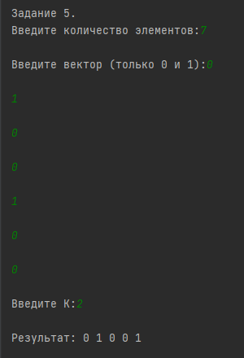

Программа нашла именно последний набор из двух нулей и удалила его.

---

## Задание 6

**Задача 8. Базовые модифицирующие алгоритмы**

**Текст задачи:**
Даны списки `L1` и `L2` с размером, кратным 4. В `L1` инвертировать первую половину (`swap_ranges` + обратные итераторы), в `L2` — вторую половину (`reverse`). Использовать `advance`.

**Алгоритм решения:**

1. Для `L1`: найти середину, применить `std::swap_ranges(L1.begin(), mid, std::make_reverse_iterator(mid))`.
2. Для `L2`: найти середину, применить `std::reverse(mid, L2.end())`.

**Тестирование:**

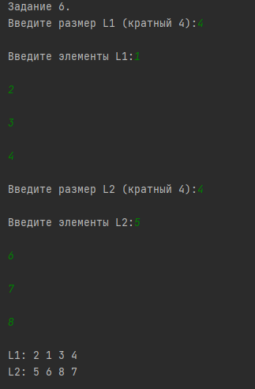

Инверсия прошла успешно ровно в тех половинах, которые были указаны в задании.

---

## Задание 7

**Задача 5. Сортировка и слияние**

**Текст задачи:**
Дан список `L`. Определить количество чётных и нечётных чисел. Использовать `partition` и `distance`.

**Алгоритм решения:**

1. Применить `std::partition` с предикатом `x % 2 == 0`.
2. Вывести `distance(L.begin(), it)` (чётные) и `distance(it, L.end())` (нечётные).

**Тестирование:**

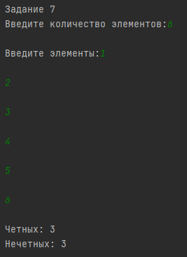

Программа корректно подсчитала количество элементов каждой группы.

---

## Задание 8

**Задача 1. Числовые алгоритмы**

**Текст задачи:**
Дан список `L`. Получить вектор `V` средних арифметических для пар соседних элементов. Использовать `adjacent_difference`.

**Алгоритм решения:**

1. Применить `std::adjacent_difference` с лямбда-функцией `(a + b) / 2.0`.
2. Удалить первый элемент вектора `V` (он копируется из первого элемента списка).

**Тестирование:**

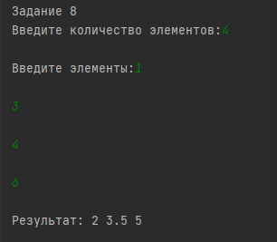

Для пар (1, 3), (3, 4), (4, 6) программа верно вычислила средние значения.

---

## Задание 9

**Задача 2. Множества**

**Текст задачи:**
Дан `V0` и набор векторов. Найти количество векторов, содержащих все элементы `V0` с учётом повторений. Использовать `multiset` и `includes`.

**Алгоритм решения:**

1. Создать `multiset` для `V0`.
2. Для каждого вектора создать `multiset` и применить `std::includes`.

**Тестирование:**

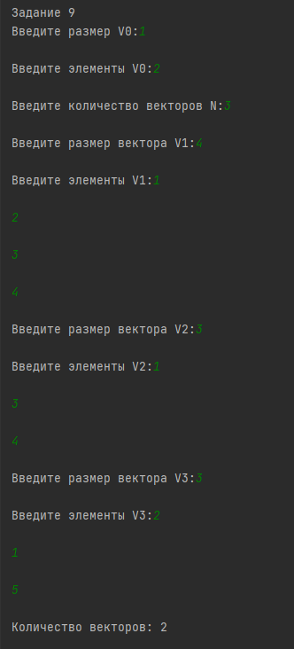

Программа правильно определила, что первый и третий векторы содержат элементы `[1, 2]` (порядок не важен, учитываются повторы).

---

## Задание 10

**Задача 4. Отображения**

**Текст задачи:**
Дан вектор слов. Сгруппировать по последней букве так, чтобы внутри группы порядок был обратным исходному. Использовать `multimap`.

**Алгоритм решения:**

1. Итерировать вектор с конца (`rbegin` — `rend`).
2. Вставлять в `multimap<char, string>` ключ (последняя буква) и значение (слово).

**Тестирование:**

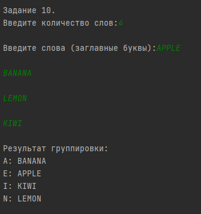

Группировка по последней букве прошла успешно, ключи в отображении отсортированы по алфавиту.
